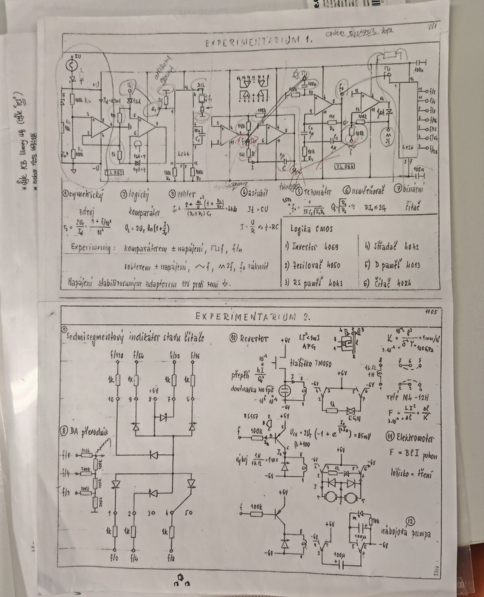
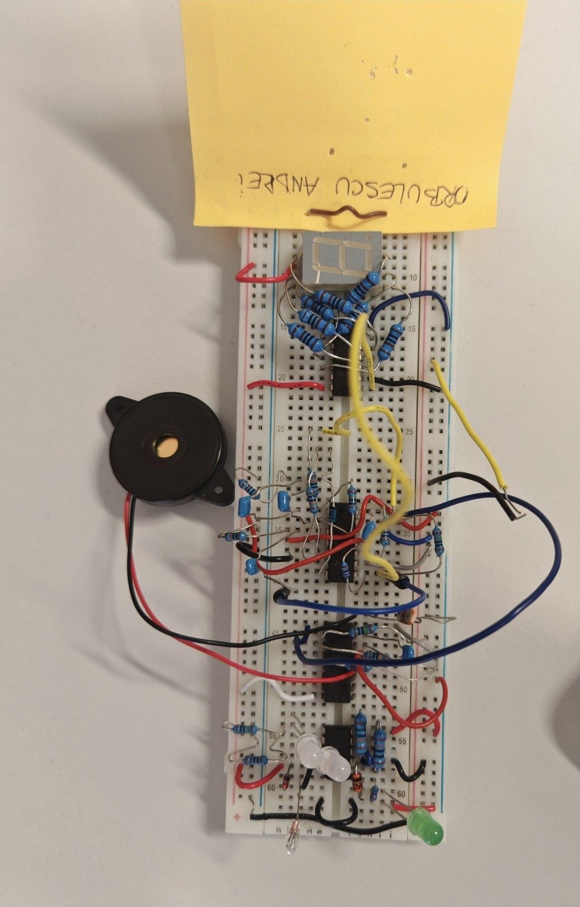

# Ambulance-Siren-System
**Overview** 
Practical project built during an Erasmus mobility program. It is a breadboard circuit that replicates an ambulance warning system, built **exclusively hardware** (no microcontroller or software code).

**Features**
* **Audio:** Accurately reproduces the ambulance siren sound using operational amplifiers.
* **Visual:** Alternating lights (red/blue) and LED indicators for system status and short-circuit detection.
* **Display:** 7-segment display controlled by BCD logic.

**Technologies Used**
* Pure analog and digital electronics.
* CMOS logic (4000 series: counters, logic gates, flip-flops).
* Basic components: breadboard, buzzer, resistors, capacitors.

**Gallery & Demonstration**
*(Make sure to upload your photos and video in the same repository)*

*Circuit schematic*

*Physical setup on the breadboard*

[🎥 Click here to watch the video demonstration](video.mp4)
